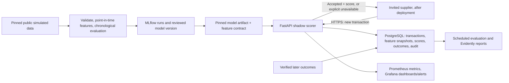

# Fraud-risk shadow API: system design

Status: single current design, reviewed with the project owner in conversation
through 2026-09-28. It replaces every earlier design document (see Section 12). This is an internal design baseline, not implementation evidence, supplier
agreement, fintech data authorization, model acceptance, or release approval.
The target is a real, bounded working system, not a throwaway demo or an
enterprise platform.

## 0. The system in six lines

1. **What it does:** a supplier submits a newly received payment-card-like
   transaction (transaction ID, customer ID, amount, currency, occurrence
   time), which may have occurred earlier. The API replies with a relative-risk
   **ranking score** (higher = more suspicious than others scored by the same
   model). It is not a probability and never approves, blocks, or routes a
   payment (shadow mode). Transactions too late to score are stored with an
   explicit `unavailable` result.
2. **Model:** first developed on public **simulated payment-card
   transactions** from the Fraud Detection Handbook, pending the source audit;
   not real card data and no evidence for other payment channels. Time-ordered
   split; MLflow records experiments and the chosen model version.
3. **Scoring:** FastAPI takes the transaction, reads that customer's *earlier*
   transactions from PostgreSQL, builds features, scores with the pinned model,
   saves everything, and replies.
4. **Safety:** identical retries return the saved answer; failed scoring says
   `unavailable` instead of inventing a score; each supplier sees only its own
   data.
5. **Monitoring:** Prometheus/Grafana for service health, Evidently for data
   shift; verified outcomes arrive later to measure real score quality.
6. **Where:** first on the owner's laptop with public data only (the 20-day
   goal); suppliers only after deployment to an approved fintech environment.

## 1. Scope and release boundary

Higher scores mean greater relative risk under the same model and feature
version only. `0.8` must not be described as an 80% chance of fraud. The fintech
owns any action policy and thresholds.

**In this release:** offline data preparation and evaluation, experiment
tracking, a pinned reviewed model, the new-transaction shadow API, durable
records, service and model monitoring, outcome import with evaluation join, and
failure/rollback drills. First client is Postman or direct HTTP.

**Not in this release:** payment integration or actions, thresholds, a browser
page (separate, later, manager-approved phase with its own design covering
identity, CORS, and token storage), anonymous access, analyst workflows,
automated retraining or promotion, and enterprise reliability infrastructure.
Human decision support is a possible later use after real-outcome validation.

**Delivery window:** target 14 working days, hard cap 20 (Section 9).
"Shipping" means passing the **local working build** gate. Supplier activation
depends additionally on the hosting, data, security, model, and service
approvals in Section 10; the schedule does not waive them.

## 2. Architecture

The diagram is logical; boxes need not be separate services. The
supplier-facing API is the only public surface. PostgreSQL, MLflow, Prometheus,
Grafana, and jobs stay private.

### Responsibilities and tools

| Responsibility | Design |
| --- | --- |
| Data preparation | Pin and validate the public source; record source/checksum and split manifests; generate decision-time-eligible features. pandas with Parquet/DuckDB. |
| Feature management | One versioned feature function used offline and online (Section 4.2). PostgreSQL holds live history and the exact snapshot used for each score. No separate feature-store service. |
| Training/evaluation | scikit-learn: amount-only baseline versus a small number of candidate tabular models on chronological data. |
| Experiment tracking and registry | MLflow (PostgreSQL backend) records configuration, data/split/feature versions, metrics, artifacts, and reviewed candidates. |
| Model caching and serving | Each API worker loads one pinned, reviewed artifact once at startup and keeps it in memory. FastAPI/Pydantic validate, authenticate, deduplicate, build features, score, save, respond. |
| Prediction reuse | PostgreSQL durably stores the original result; an identical retry returns it. Not an ephemeral cache. |
| Service monitoring | Prometheus metrics, Grafana dashboards/alerts, structured logs. |
| Model monitoring | Scheduled Evidently report on input quality and feature/score distributions. Drift is a proxy, not measured accuracy. |
| Feedback/evaluation | Verified outcomes joined later to saved scores; retraining and promotion are manual, reviewed actions. |
| Delivery | Docker Compose locally and as a single-server candidate; GitHub Actions runs quality gates and image build. |

Exact library versions are resolved and tested during implementation. Customer
history and whole API responses are not cached.

### Tool adoption triggers

These tools are not used by name alone; each needs the stated trigger:

| Tool | Adopt only when |
| --- | --- |
| Redis | Multiple workers need a shared rate-limit counter, or measured history reads are too slow |
| Feast | Feature reuse across teams/models or online materialization is needed beyond one feature function |
| DVC | Large dataset versions must be shared or restored through a remote cache |
| Prefect/Airflow | Jobs need scheduling, retries, or operator workflow beyond cron-style scripts |
| Kafka | A real asynchronous event-ingestion need exists |
| Kubernetes | The approved host requires it |
| MinIO/object store | MLflow artifacts must be durable beyond a local volume on the chosen host |

## 3. Data, features, and offline evaluation

### 3.1 Public source

Source: the Fraud Detection Handbook's
[transformed simulated data](https://github.com/Fraud-Detection-Handbook/simulated-data-transformed/tree/main/data)
(daily pickle files). Its
[transformation chapter](https://fraud-detection-handbook.github.io/fraud-detection-handbook/Chapter_3_GettingStarted/BaselineFeatureTransformation.html)
documents transaction, customer, terminal, amount, time, and label fields. The
actual files have **not** been inspected yet.

Known limits from the published documentation:

- Customer rolling aggregates include the current transaction, so they fail
  this design's exclusive-prior rule; recompute history instead of using them.
- Terminal-risk aggregates depend on labels and a simulated 7-day delay; they
  are excluded from the first model.
- The [simulator](https://fraud-detection-handbook.github.io/fraud-detection-handbook/Chapter_3_GettingStarted/SimulatedDataset.html)
  makes some fraud directly from an amount rule; strong offline results may
  partly measure recovery of that rule.
- No currency field is documented; amount is a simulation-specific unit.
- `TX_DATETIME` is timezone-naive.

The public data is for offline development and technical evaluation. It does
not supply real customer history, prove performance on fintech traffic, or show
business impact.

### 3.2 Source audit (first build task, OD-02)

Before fixing model inputs: pin an immutable source commit and per-file
SHA-256; verify data-use and redistribution terms from actual source evidence
(public visibility is not a license); load only reviewed files, because pickle
deserialization executes code; inspect columns, types, missingness, event
range, duplicate keys, and label distribution. If actual files contradict the
documentation, stop and revise the data contract. Record results in
`docs/data-source-audit.md` and a dataset manifest.

The audit also fixes the **local simulation conventions**, each labeled as
simulation, not real-world fact:

- how naive `TX_DATETIME` maps to UTC (`timezone: simulated_utc`); no
  time-of-day features unless timezone meaning is documented;
- one fixed simulated currency code for local API requests;
- simulated availability time equals event time for public records;
- a configurable, provisional late-event cutoff (real value: OD-07).

### 3.3 Features

Candidate first-model inputs: current amount and exclusive-prior customer
transaction counts and mean amounts over versioned time windows (proposed
1, 7, and 30 days; final list after the audit). Customer/transaction IDs,
simulator scenario, labels, and terminal-risk fields are never model inputs.

**Eligibility rule.** A prior transaction contributes to features only if all
hold:

- it belongs to the same `(supplier_id, customer_id)`;
- it became available **strictly before** the decision cutoff;
- its event time is **strictly before** the current transaction's event time;
- it is not the current transaction.

**One feature function.** A single pure Python function,
`compute_features(prior, current, spec) -> FeatureSnapshot`, applies the rule
and computes the values. Offline code calls it per transaction with that
customer's earlier rows; the API calls it with rows read from PostgreSQL. The
function, not its callers, is the authority on eligibility, so offline and
online parity holds by construction and is proven by tests (Section 10).

A snapshot carries feature version, decision cutoff, ordered values, and
`history_status` (`no_history` or `has_history`). Cold start is explicit: an
empty window has count `0` and mean *missing*, never an implicit zero. Missing
values are handled by train-fitted preprocessing (imputation plus missing
indicator).

### 3.4 Splits, models, and evaluation

- Chronological train / validation / final-test periods by distinct days
  (proposed 60/20/20; actual boundaries recorded in the manifest).
- Fit preprocessing on training data only; select using validation; inspect
  the final period **once** after selection.
- Compare the amount-only baseline with a small number of candidate models.
- Report average precision, prevalence, precision and capture at top-k volumes
  (k declared before final-test review), time and cold-start slices, and
  simulator-scenario diagnostics where available.
- Show high-scoring legitimate and low-scoring fraudulent final-period examples.
- A period with a single class fails metric generation explicitly.
- No numeric pass target is invented. If the model does not beat the baseline
  on validation, show the evidence and let the owner decide.

### 3.5 Model artifact and reproducibility

The reviewed artifact contains the fitted preprocessing and model plus
`feature_contract.json` (feature version, ordered names, windows) and a SHA-256
digest. A score is reconstructable from: transaction ID and scoring time,
feature snapshot, source/split/feature versions, decision cutoff, artifact
digest, code revision, dependency lock or image digest, configuration, and
score semantics. All of these are recorded in MLflow and the manifests.

## 4. Online scoring

### 4.1 Request contract

`POST /v1/transactions` with provisional fields `transaction_id`, stable
`customer_id`, `occurred_at`, `amount`, `currency`. The credential determines
`supplier_id`; callers cannot choose it. The service records receipt time.
Merchant/terminal fields wait for the audit and supplier contract. Fraud labels
are never accepted. Only approved attributes are stored, never arbitrary
payload fields.

### 4.2 History and ordering

Features come only from the same supplier's customer history under the
eligibility rule in 3.3. History builds from each supplier's own accepted
traffic. A late-arriving event is stored and may feed *future* history but
never rewrites a past score; if too late to score under the cutoff, the result
is `unavailable` with reason `late`.

Same-customer decisions are serialized: each request runs in one PostgreSQL
transaction holding `pg_advisory_xact_lock` on a hash of
`(supplier_id, customer_id)`. The request reads eligible history, scores, and
commits inside that lock, so concurrent requests get a deterministic order.

### 4.3 Idempotency

Dedup key: `(supplier_id, transaction_id)`, enforced by a unique constraint.
The canonical validated request is hashed and stored. Same key and hash: return
the original saved result (HTTP 200) with no new history or inference. Same key,
different hash: 409. Corrections require a separate explicit process.

### 4.4 Logical records

| Record | Minimum content |
| --- | --- |
| Accepted transaction | Tenant-scoped transaction/customer IDs, approved attributes, event and receipt times, request hash, acceptance time |
| Feature snapshot | Decision cutoff, feature version, ordered values, history status; or absent with an explicit failure reason |
| Score result | `kind` (`original` or `replay`), status, nullable score, machine-readable reason (`late`, `feature_failure`, `model_unavailable`), scoring time, model/feature versions when known |
| Outcome | Immutable assertion with evidence, effective and availability times, optional `supersedes` link |
| Audit event | Time, request ID, failure category, route, authenticated supplier when known; no payload, credential, or raw customer ID |

Physical schema and indexes are fixed in implementation and reviewed against
the supplier contract before real traffic.

### 4.5 Request sequence and responses

Order: authenticate; apply size, rate, and field checks; resolve the
tenant-scoped ID; take the customer lock; read eligible history; build features
and score, or mark unavailable; durably commit transaction, snapshot, and
original result; respond.

A success body contains transaction ID, acceptance time, `score_status`,
nullable score, reason when unavailable, `score_kind: "ranking"`, model/feature
versions, history status, request ID, and a notice that the score is not a
probability. It contains no label, payment action, or customer history.

| Case | HTTP | History effect |
| --- | --- | --- |
| New valid transaction, scored or unavailable | 201 | Saved once with original result |
| Identical retry | 200, original result | None |
| Same ID, different content | 409 | None |
| Invalid fields / oversized / rate-limited | 422 / 413 / 429 (`Retry-After`) | None; minimal audit where possible |
| Authentication / authorization failure | 401 / 403 | None; minimal audit where possible |
| Store unavailable or commit unconfirmed | 503, retryable, no acceptance claim | Unknown until idempotent retry resolves it |
| Unexpected error | 500, generic message | None claimed |

All errors share one envelope: `error.code`, `error.message`, `request_id`. The
request ID is also returned in `X-Request-ID`. Responses carry
`Cache-Control: no-store`. PostgreSQL is authoritative for acceptance; no cache
may claim it.

### 4.6 Access control and limits

Per-supplier revocable bearer tokens stored outside source control, compared in
constant time. Authentication happens before any lookup. Authorization is
checked on every resource access, not inferred from a transaction ID. Suppliers
may submit and receive results for their own submissions only; no endpoint
browses customer history.

Per-supplier rate limits are configurable. A single local process enforces
them in memory; multiple deployed workers need a shared counter or gateway.
Numeric limits, burst policy, and limiter-outage behavior belong to security
and platform owners (OD-06). Bounded request size and timeouts apply.

### 4.7 Health

`GET /health/live` reports the process. `GET /health/ready` requires a
compatible pinned model and a usable transaction store. Neither reveals data
or secrets.

## 5. Model lifecycle and replay

Each worker loads the pinned artifact and feature contract before becoming
ready and verifies digest and contract. It never fetches from MLflow per
request, and never follows a moving alias. A failed load leaves the worker
unready; the previous reviewed version stays the rollback candidate. Version
changes use a controlled deployment, not hot-swapping. Budget worker count
against per-worker model memory.

The original saved result answers identical retries even after a newer model
is deployed. After an outage, a separate controlled replay may create a new
`replay` score record for an accepted transaction whose original result was
unavailable, using the saved snapshot or an equivalent point-in-time
reconstruction. If neither exists, no replay score is produced. Replay never
rewrites the original, never claims availability at submission, and never adds
history. Supplier access to replay results is a separate decision (OD-09).

## 6. Outcomes and model monitoring

Outcomes arrive separately and later, never in a scoring request. Fraud and
legitimate outcomes require owner-supplied evidence rules. Missing, disputed,
immature, or unreported outcomes remain **unknown**; time passing never turns
them legitimate. Corrections supersede immutably. Delivery: authenticated
outcome API if suppliers can send updates, otherwise controlled periodic import
(file-based for the local build).

When verified outcomes mature, a scheduled job joins them to the **historical
score and version** and reports ranking performance by time and slice, recorded
in MLflow. Until then, real-world performance is `unknown`. Never train on
unverified outcomes or retrain/promote automatically.

Scheduled Evidently reports check missingness and feature/score shifts once
enough data exists. Public data is not an automatic reference for real traffic;
establish a live comparison window. Drift alone does not prove worse detection.

## 7. Operations

Prometheus metrics cover request outcomes and duration, database and score
availability, cold starts, late events, retries and conflicts, feature
failures, model-load and replay failures. Labels are bounded, never customer
IDs. Structured logs correlate request IDs without payloads, tokens, or feature
rows. Grafana shows dashboards and alerts on these signals.

Database outage prevents confirmed acceptance; scoring failure still yields a
durably accepted `unavailable` result. Releases keep the prior app image and
reviewed model, plan database changes for rollback, and rehearse
backup/restore. Recovery targets need platform-owner approval before supplier
access.

## 8. Data use, security, and deployment

Laptop work uses only public or synthetic records. Local test transactions are
never copied into a live history database. Before any real fintech data is
inspected or accepted, one recorded authorization must cover purposes and
fields, environment and access paths, classification and masking, residency,
retention and deletion, export restrictions, owners, approvers, and evidence.

Supplier traffic requires an approved host: HTTPS entry, tenant checks at the
API, private PostgreSQL/MLflow/metrics/jobs, durable model artifacts, managed
secrets, and audited admin access. The host may be one server or managed cloud;
single-server Docker Compose is a candidate, not a commitment. Security review
covers payload and rate limits, secrets, and cross-supplier access tests.

## 9. Build order (approved 2026-09-28)

All components are in the first release. Target 14 working days, hard cap 20.

| Days | Work | Exit evidence |
| --- | --- | --- |
| 1–2 | Source audit and local simulation conventions (3.2) | `docs/data-source-audit.md`, dataset manifest |
| 3–4 | Feature function, chronological splits | Eligibility-rule tests, split manifest |
| 5–6 | Baseline and candidate models, MLflow, pinned artifact | MLflow run, validation report, artifact digest |
| 7–9 | FastAPI and PostgreSQL: history, lock, idempotency, unavailable results, auth, rate limits; Docker Compose | Tests for every row of the 4.5 table |
| 10 | Local history loaded through the ingestion path; Postman end-to-end | Postman collection, offline/online parity test |
| 11 | Prometheus, structured logs, Grafana dashboard and alerts | Dashboard and a triggered test alert |
| 12 | Evidently report, outcome import, evaluation join | Report and MLflow-recorded evaluation |
| 13 | Drills: model load, rollback, uncertain commit, backup/restore | Recorded drill results |
| 14 | Gate evidence, README, handoff | Completed local-build checklist |
| 15–20 | Buffer only; no new scope | — |

**Local history:** a local-only database is filled by sending public
validation-period transactions through the real ingestion code (not raw
inserts), tagged as local simulation. Postman calls on later transactions then
have real history, and the same run supplies parity evidence.

**If work slips:** keep every component but thinner: one Grafana dashboard with
a few alerts, one scheduled Evidently script, file-based outcome import.

## 10. Release gates and verification

| Gate | Evidence | Permission conveyed |
| --- | --- | --- |
| Local working build | End-to-end Postman flow on public/synthetic data and all tests below | Technical local review only |
| Supplier shadow release | Approved environment and data authorization; supplier identity/isolation and API contract; security/load tests against approved targets; backup/restore and rollback; model and service acceptance records | Invited supplier submissions, non-intervening scores only |
| Human decision support | Mature verified outcomes, independently reviewed model results, operating procedure and ownership | People may use scores to inform review; no automatic action |

Required tests for the local build:

| Area | Tests |
| --- | --- |
| Data and ML | Source validation rejects bad IDs/schemas; forbidden predictors rejected; eligibility-rule fixtures (ties, late arrival, own ID, cold start, window edges); train-only preprocessing; single-class period fails; offline/online parity |
| API | Every 4.5 row; tenant isolation; auth before lookup; error envelope, request ID, no-store; no label/secret leakage in responses or logs; uncertain-commit retry; concurrent same-customer ordering |
| Lifecycle | Bad artifact fails readiness; rollback to prior artifact returns same scores; replay never rewrites the original; unknown outcomes never become legitimate |
| Operations | Metrics exposed; alert fires; backup/restore demonstrated |

The business-risk owner and an independent model validator approve model
acceptance. Product and payment-platform/SRE owners approve latency,
throughput, availability, timeout, and fallback requirements. ML-team review
alone is not release approval. No named approvers, sign-offs, targets, or
hosting commitment exist yet.

## 11. Open decisions

| ID | Decision / evidence needed | Owners |
| --- | --- | --- |
| OD-01 | First supplier, population, fields, scoring moment, response deadline, exclusions | Product sponsor, payment-authorization owner |
| OD-02 | Public data schema, provenance, integrity, terms, feature suitability | Project data owner (build days 1–2) |
| OD-03 | Real-data authorization and host controls | Fintech data/privacy/security and platform owners |
| OD-04 | Fraud/legitimate evidence, maturity, corrections, outcome delivery path | Fraud operations and data owners |
| OD-05 | Score interpretation and model acceptance criteria | Business-risk owner, independent validator |
| OD-06 | Latency, throughput, availability, fallback, rate/burst, limiter outage, backup/recovery targets | Product, payment-platform/SRE, security |
| OD-07 | Final request/response fields, amount/currency, timezone, late-event cutoff | Product, supplier integration, payment platform |
| OD-08 | Transaction/audit retention, audit durability, deletion, export | Data/privacy/security owners |
| OD-09 | Supplier access to replay results or notifications | Product and security owners |

Record material decisions with ID, question, decision, status, owner,
approvers, evidence, dates, revisit trigger, and risks. A conversation is not
external stakeholder approval.

## 12. Existing code and earlier documents

The Sprint 0 modules are reused where their semantics fit:

- `temporal.py`: point-in-time filtering. Online features must use strict
  (exclusive) cutoffs; the default `inclusive=True` is not used for the
  eligibility rule. Naive public timestamps pass only through the documented
  simulation convention.
- `outcomes.py`: immutable superseding outcomes; `None` means unknown. Fits
  Section 6 as is.
- `contracts.py`: `ScoreResult` must be aligned with 4.4: machine-readable
  reasons, `history_status`, `kind`, and nullable model version when no model
  was attempted.

This document replaces and merges all earlier design material, which was
removed on 2026-09-28: the fixed-ID replay spec and plan (2026-09-25), the two
shadow-API drafts (2026-09-26), and the bank-phase `.plan/` notes. It also
supersedes proposal P003 (evaluated artifact as first release) in
`.codex/decisions.md`.

This document records design, not completed implementation. No model, API,
data audit, deployment, supplier integration, or test result is claimed.
